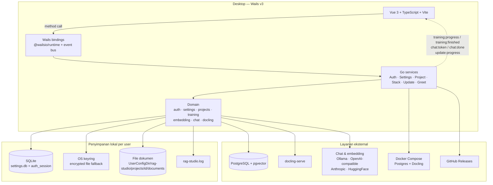
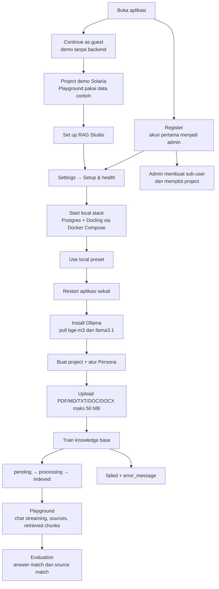
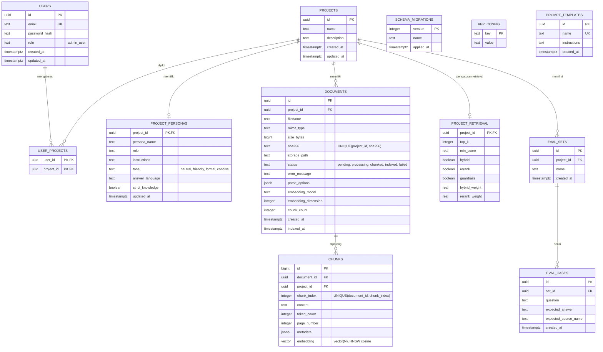
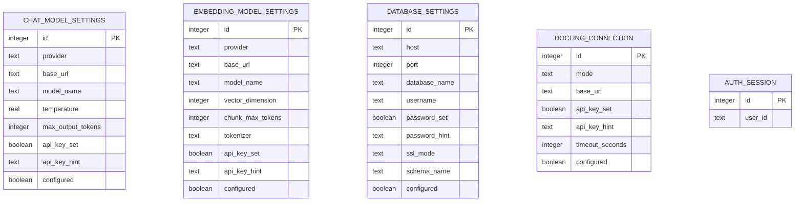

# RAG Studio

RAG Studio adalah aplikasi desktop untuk menyiapkan project RAG. Setiap project menyimpan dokumen dan persona sendiri, sehingga knowledge base antarproject tidak tercampur.

Aplikasi menyediakan pengaturan chat model, embedding model, PostgreSQL, dan Docling. Playground dipakai untuk menguji apakah jawaban model sudah sesuai dengan knowledge base project.

## Daftar isi

- [Panduan cepat](#panduan-cepat)
- [Prasyarat](#prasyarat)
- [Instalasi](#instalasi)
- [First-run setup](#first-run-setup)
- [Arsitektur](#arsitektur)
- [Alur aplikasi](#alur-aplikasi)
- [Model data](#model-data)
- [Konfigurasi](#konfigurasi)
- [Keamanan kredensial](#keamanan-kredensial)
- [Mode server](#mode-server)
- [Verifikasi rilis](#verifikasi-rilis)
- [Troubleshooting](#troubleshooting)
- [Build dari sumber](#build-dari-sumber)
- [Pengujian](#pengujian)
- [Status implementasi](#status-implementasi)
- [Struktur direktori](#struktur-direktori)

## Panduan cepat

Dua jalur yang tersedia:

**Coba tanpa setup.** Jalankan aplikasi, lalu pilih **Continue as guest**. Mode ini memakai project contoh `Demo — Solaria` dan data contoh. Tidak perlu Docker, PostgreSQL, Docling, atau Ollama. Aksi yang mengubah data dinonaktifkan.

**Pakai knowledge base sendiri.** Siapkan Docker dan Ollama, jalankan stack lokal dari menu **Settings → Setup & health**, daftar akun admin pertama, lalu buat project dan latih dokumen. Langkapnya ada di [First-run setup](#first-run-setup).

## Prasyarat

| Skenario | Yang diperlukan |
| --- | --- |
| Demo guest | Aplikasi saja |
| Stack lokal | Docker Engine + Docker Compose plugin, library GTK4/WebKitGTK di Linux atau WebView2 di Windows, Ollama yang dipasang user |
| API hosted | PostgreSQL + pgvector, docling-serve, API key penyedia model |
| Mode server | Docker, environment variable untuk rahasia, opsional sertifikat Authenticode untuk installer Windows |

Docker hanya diperlukan untuk menjalankan PostgreSQL dan Docling. Ollama tidak ikut dibundling dan tidak diunduh otomatis.

## Instalasi

Aset release tersedia di `https://github.com/RP-Guruh/rag-studio/releases`.

**Debian/Ubuntu**

```bash
sudo apt install ./rag-studio_0.1.3_amd64.deb
rag-studio
```

Package `.deb` menarik dependensi `libgtk-4-1` dan `libwebkitgtk-6.0-4` lewat apt.

**Windows**

Jalankan `rag-studio-0.1.3-windows-amd64-setup.exe`, lalu buka RAG Studio dari Start Menu. WebView2 biasanya sudah tersedia di Windows 10/11.

**Arsip Linux/macOS**

```bash
mkdir -p ~/rag-studio
cd ~/rag-studio
tar -xzf ~/Downloads/rag-studio-v0.1.3-linux-amd64.tar.gz
sudo apt install -y libgtk-4-1 libwebkitgtk-6.0-4
chmod +x rag-studio
./rag-studio
```

## First-run setup

1. Buka aplikasi, lalu pada layar login pilih **Set up RAG Studio first (Docker, database, models)**. Halaman setup sengaja bisa dibuka sebelum ada akun.
2. Buka **Settings → Setup & health**, lalu klik **Start local stack**. Docker menjalankan `pgvector/pgvector:pg16` dan `docling-serve`.
3. Tunggu status `PostgreSQL: ready` dan `Docling: ready`. Klik **Refresh** bila perlu.
4. Klik **Use local preset**. Pengaturan Database, Docling, embedding, dan chat model terisi otomatis.
5. Restart aplikasi sekali agar migrasi PostgreSQL berjalan dengan konfigurasi baru.
6. Pasang Ollama dari `ollama.com/download`, jalankan `ollama serve`, lalu tarik model:

```bash
ollama pull bge-m3
ollama pull llama3.1
```

7. Kembali ke layar login, lalu daftar akun pertama. Akun ini menjadi admin.
8. Buat project lewat tombol **New project**, atur tab **Persona**, lalu upload dokumen di tab **Knowledge Base**.
9. Klik **Train knowledge base**. Tunggu status dokumen menjadi **Ready**.
10. Buka **Playground** dan ajukan pertanyaan. Panel kanan menampilkan retrieved chunks. Tab **Evaluation** dipakai untuk mengukur kecocokan jawaban dan sumber.

Admin dapat membuat sub-user di **Settings → Users** dan memilih project yang diplot kepadanya. Sub-user bersifat **read-only**: hanya melihat dan bertanya pada project yang di-assign; tidak bisa menambah/mengubah project, mengubah persona, training, maupun membuka Settings.

## Arsitektur



`main.go` menyambungkan store ke service Wails, menjalankan migrasi PostgreSQL saat startup bila konfigurasi sudah lengkap, lalu membuka window 1024×768. Frontend memanggil backend lewat binding dan tidak membuka PostgreSQL atau keyring sendiri.

`ProjectService` membuka koneksi PostgreSQL per operasi. `training.Manager` menjalankan maksimal dua worker dan memancarkan progres lewat event Wails.

## Alur aplikasi



Saat training berjalan, Docling memotong dokumen, embedder membuat vektor, lalu `chunks.embedding` diisi. Dokumen ditandai `indexed` hanya setelah semua chunk tersimpan.

## Model data

### PostgreSQL



Indeks yang dipakai:

- `idx_documents_project` untuk dokumen per project.
- `idx_chunks_project` membatasi pencarian ke satu project.
- `idx_chunks_embedding` memakai HNSW dengan `vector_cosine_ops`.
- `ON DELETE CASCADE` dari `projects → documents → chunks` menghapus turunan saat project dihapus.

### SQLite



Tabel konfigurasi berisi satu baris dengan `id = 1`. Nilai `configured` dihitung dari keberadaan baris, bukan kolom tersimpan. Kunci API dan password tidak disimpan di SQLite, hanya status `set` dan hint.

## Konfigurasi

| Halaman | Field utama | Catatan |
| --- | --- | --- |
| Setup & health | Status Docker, Postgres, Docling, Ollama | Start/stop stack lokal dan terapkan preset |
| Chat model | Provider, base URL, API key, model, temperature, max tokens | Provider: OpenAI-compatible, Anthropic, Ollama |
| Embedding model | Provider, base URL, API key, model, dimensi, chunk max tokens, tokenizer | Provider: OpenAI-compatible, Ollama, HuggingFace |
| Database | Host, port, nama, user, password, SSL, schema | Save menjalankan migrasi PostgreSQL |
| Document processing | Mode, base URL, timeout, API key | `serve` memakai docling-serve; `local` berarti server di mesin sendiri |
| Users | Email, password, plot project | Hanya admin |

Mengubah model atau dimensi embedding memerlukan re-index. Aplikasi menghapus vektor lama dan mereset dokumen agar di-embed ulang.

## Keamanan kredensial

API key dan password database disimpan di OS keyring. Bila keyring tidak tersedia, dipakai file terenkripsi di direktori konfigurasi. SQLite hanya menyimpan flag `set` dan hint.

Password akun di-hash dengan bcrypt di PostgreSQL. Session desktop disimpan di SQLite. Mode server membaca rahasia dari environment variable `RAG_STUDIO_*`.

## Mode server

File `deploy/server/docker-compose.yml` menjalankan aplikasi dalam mode server bersama PostgreSQL dan Docling. Aktifkan dengan `RAG_STUDIO_SERVER=1`.

Environment variable yang dipakai:

- `RAG_STUDIO_CONFIG_DIR` untuk direktori data.
- `RAG_STUDIO_CHAT_API_KEY`, `RAG_STUDIO_EMBEDDING_API_KEY`, `RAG_STUDIO_DOCLING_API_KEY`, `RAG_STUDIO_DB_PASSWORD`.
- `RAG_DB_PASSWORD` untuk container PostgreSQL.

Admin dan sub-user memakai database yang sama dengan mode desktop.

## Verifikasi rilis

Setiap rilis menyertakan `SHA256SUMS`.

```bash
sha256sum -c SHA256SUMS --ignore-missing
```

Package `.deb` ditandatangani dengan kunci rilis. Import kunci publik dan verifikasi:

```bash
gpg --import docs/rag-studio-release.gpg.key
gpg --fingerprint 863320B6B89B26B2988B55883D8DC7AC7D242CF0
dpkg-sig --verify rag-studio_0.1.3_amd64.deb
gpg --verify rag-studio_0.1.3_amd64.deb.asc rag-studio_0.1.3_amd64.deb
```

Fingerprint: `863320B6B89B26B2988B55883D8DC7AC7D242CF0`.

Untuk maintainer, workflow membutuhkan secret `GPG_PRIVATE_KEY`, `GPG_KEY_ID`, dan `GPG_PASSPHRASE` bila kunci dilindungi. Installer Windows ditandatangani bila `WINDOWS_PFX_BASE64` dan `WINDOWS_PFX_PASSWORD` tersedia.

## Troubleshooting

**Register gagal dengan pesan `database is not configured`.** Buka **Settings → Setup & health** lebih dulu, jalankan stack lokal, terapkan preset, lalu restart aplikasi.

**`docker compose up` exit 1.** Periksa hal berikut:

```bash
docker compose version
docker info
ss -ltnp | grep -E '5432|5001'
cd ~/.config/rag-studio/stack && docker compose up -d && docker compose logs --tail=100
```

User harus masuk grup `docker`, lalu logout dan login ulang setelah `usermod -aG docker $USER`.

Bila error menyebut `docker-credential-desktop` atau `error getting credentials`, file `~/.docker/config.json` masih memakai credential helper Docker Desktop. Hapus `"credsStore": "desktop"` sehingga berisi `{"auths": {}}`, atau install Docker Desktop. Aplikasi juga menyediakan tombol **Retry with clean Docker config** yang menjalankan stack dengan konfigurasi Docker terisolasi.

**Status Docling tetap stopped.** Periksa `docker compose ps -a` dan log container. Port 5001 tidak boleh dipakai layanan lain.

**Ollama tidak terdeteksi.** Jalankan `ollama serve`, lalu pastikan `http://localhost:11434/api/tags` merespons.

**Jawaban menyatakan knowledge base kosong.** Dokumen belum berstatus `Ready`. Klik **Re-index knowledge base**, lalu tunggu proses selesai.

## Build dari sumber

Prasyarat: Go 1.26 atau lebih baru, Node.js dan npm, Wails v3 CLI, serta Task.

```bash
cd frontend && npm install && cd ..
task dev
task build
task package
task bindings
```

Regenerate binding diperlukan setelah method Go diubah.

## Pengujian

```bash
go test ./internal/auth ./internal/chat ./internal/embedding ./internal/projects ./internal/settings ./internal/training ./internal/stack
cd frontend && npm run build:dev
```

Paket yang bergantung pada Wails tidak dapat di-test penuh di Linux tanpa library GTK4 dan WebKitGTK. Pengecekan tipe dapat dilakukan dengan:

```bash
GOOS=windows GOARCH=amd64 CGO_ENABLED=0 go build .
```

## Status implementasi

| Fitur | Status |
| --- | --- |
| Settings, migrasi PostgreSQL, project, persona | Selesai |
| Upload dokumen, dedup SHA-256, training, embedding, vektor | Selesai |
| Playground chat streaming, sources, retrieved chunks, panel debug | Selesai |
| Auth admin, sub-user, plot project, demo guest | Selesai |
| Evaluation, retrieval tuning, export/import, backup | Selesai |
| Local stack Docker Compose, health dashboard | Selesai |
| GitHub Releases, checksum, tanda tangan GPG | Selesai |
| Tanda tangan Authenticode Windows | Menunggu sertifikat |

## Struktur direktori

```text
main.go                  composition root Wails
internal/auth            akun, session, otorisasi project
internal/chat            chat client, prompt, guardrail, streaming
internal/docling         adapter doclingclient
internal/embedding       embedder untuk tiga provider
internal/projects        model, store PostgreSQL, skema, retrieval, evaluasi
internal/service         service yang di-bind ke Wails
internal/settings        model, store SQLite, secret store, probe koneksi
internal/stack           StackService untuk Docker Compose lokal
internal/training        manager worker dan pipeline chunking
internal/update          pengecekan dan unduhan GitHub Releases
frontend/src             Vue 3, pages, services, styles
frontend/bindings        binding TypeScript hasil generate Wails
deploy/local             docker-compose.yml untuk stack lokal
deploy/server            docker-compose.yml untuk mode server
deploy/linux             skrip build .deb
deploy/windows           skrip installer Inno Setup
```

